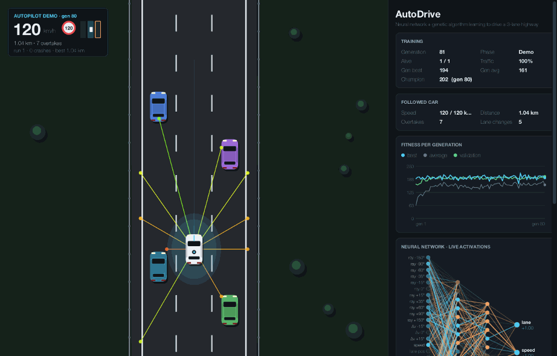

# AutoDrive

[](https://github.com/nevanvu/autodrive/actions/workflows/ci.yml)
[](https://adoptium.net/)
[](LICENSE)

**A self-driving car that teaches itself to drive a busy highway.** A population of cars, each
controlled by a small neural network, is evolved by a genetic algorithm until it can keep a safe
distance, obey the speed limit and overtake slow traffic. Nobody writes any driving rules.

Everything is built from scratch: the neural network, the genetic algorithm, the traffic
simulation and the visualisation, with no machine-learning libraries.

**Tech:** Java 21 · JavaFX · Maven · JUnit 5 · GitHub Actions



*The trained car (white) catches up to a slower car and slows to its speed. It wants to pass, but
a car alongside blocks the next lane, so its safety system holds the lane change (the lane
outlined in amber in the top-left map). Once the lane is clear it moves over, overtakes and gets
back up to the 120 km/h limit. The lines are its distance sensors; the panel on the right shows
training progress and its neural network firing live.*

## Results

A brain trained for 80 generations (about 3 minutes on a laptop), then tested on 50 highways it
never saw during training:

| | |
|---|---|
| Crashes | **0 out of 50** |
| Average speed | 100 km/h (limit 120, never exceeded) |
| Overtakes | 13 per 60-second highway |
| Following distance | median 3.4 car lengths (0.74 s) |
| Time spent too close to the car ahead | 0.1% |

Training is random, so I repeated it with three different random seeds. All three brains finished
all 50 test highways without a crash, with nearly identical scores.

## Highlights

- **Neuroevolution from scratch.** A small neural network (27 inputs → 14 → 9 → 2) whose weights
  are evolved, not hand-tuned: the best drivers survive, and the next generation comes from
  combining and mutating them.
- **A layered driving stack, like real autonomous cars.** The network is the *planner*: it decides
  when to change lanes and how fast to go. Simple hand-built controllers carry out the plan: a
  lane-change safety check, adaptive cruise control and lane keeping.
- **Realistic sensors.** 11 distance sensors that also measure closing speed (like radar), a
  blind-spot radar for the neighbouring lanes, and a detector for other cars' turn signals.
- **Traffic that reacts.** Other cars follow a standard traffic model (the Intelligent Driver
  Model), signal before changing lanes and brake for the AI car.
- **Built to generalize, and measured honestly.** Every generation drives a new random highway, and
  the reported results come from a separate set of test highways that is never used during
  training.
- **Reproducible and tested.** The same random seed always replays the same drive. The simulation
  runs without a window, so it can train from the command line and is covered by unit tests that
  run on every push.

## Try it

You need [JDK 21 or newer](https://adoptium.net/). The included Maven wrapper downloads everything
else.

```bash
git clone https://github.com/nevanvu/autodrive.git
cd autodrive
./mvnw javafx:run
```

On Windows, use `mvnw.cmd javafx:run`.

The app starts training from scratch with 150 random brains, so the first cars crash almost
immediately. Set **Speed** to **Max** to train quickly; after 5 to 10 generations, press **Watch
champion drive** to see the best brain so far on an endless highway.

| Control | What it does |
|---|---|
| **Speed** 1× … Max | How fast the simulation runs. Max is roughly 100× real time |
| **Watch champion drive** | Endless highway driven by the best brain so far. Restarts on a crash |
| **Save brain… / Load brain…** | Save the best brain to a file, or load one and keep training from it |
| **Control mode** | *Planner* (the default, described below) or *Direct* steering and throttle, which is much harder to learn |
| **Traffic density**, **Traffic changes lanes** | Make the highway busier or calmer |
| Keys | `Space` pause · `D` watch the champion · `S` show or hide sensors |

### Train and test from the command line

Train for 80 generations with seed 42, save the best brain, then score it on the 50 test highways:

```bash
./mvnw compile exec:java -Dexec.args="80 42 champion.brain"
./mvnw compile exec:java@benchmark -Dexec.args="champion.brain"
```

The benchmark reports crashes, speed, overtakes, following distance and more, and can compare
several brain files side by side. You can also load a saved brain in the app.

Run the tests with `./mvnw test`.

## How it works

```
sense ─────────────▶ think ──────────────▶ act ──────────────────────▶ score
11 distance sensors  27 → 14 → 9 → 2       network plans lane + speed   progress, overtakes,
radar closing speed  neural network        → lane-change safety check   safe following,
blind-spot radar                           → adaptive cruise ≤ limit    smoothness, crashes
turn-signal detector                       → lane keeping
```

1. **Sense.** Each car reads its distance sensors, the blind-spot radar and the turn-signal
   detector.
2. **Think.** The network turns those readings into two numbers: whether to change lanes, and a
   target speed (capped at the speed limit).
3. **Act.** The safety check only allows a lane change when there is enough room ahead and behind
   in the target lane, adaptive cruise control keeps a safe distance to the car ahead, and lane
   keeping steers to the centre of the lane.
4. **Score.** Each brain gets a score that rewards distance covered and overtakes, and penalizes
   crashes, tailgating, closing in too fast, harsh braking, jerky steering and staying stuck behind
   a slow car when a faster lane is open.
5. **Evolve.** The best brains are kept, the rest are replaced by mutated combinations of strong
   ones, and the cycle repeats.

## Project layout

```
src/main/java/dev/autodrive/
  App.java, Launcher.java   JavaFX window and control panel
  sim/    world, traffic model, the AI car and its sensors
  ai/     neural network, genetic algorithm, brain file format
  train/  training loop, command-line training, benchmark
  ui/     road, network and chart rendering
```

## Ideas for the future

- Evolve the network's structure as well as its weights (NEAT)
- On-ramps, changing speed limits and different lane counts
- Compare the genetic algorithm with reinforcement learning (PPO)

## License

[MIT](LICENSE)
