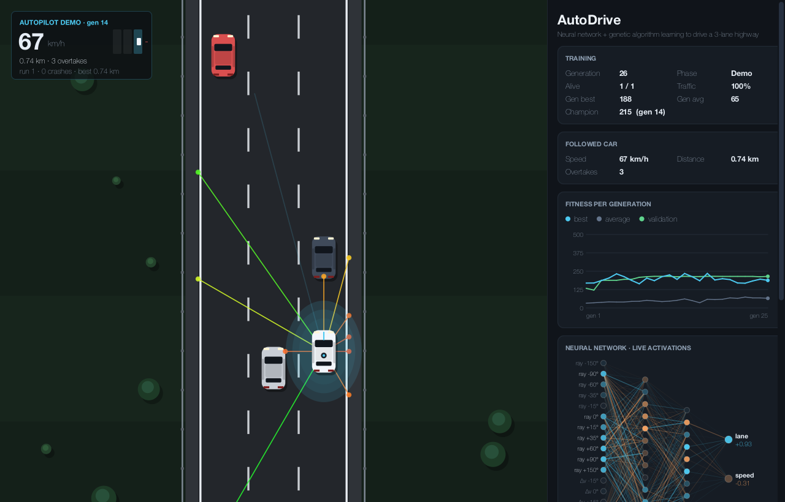

# AutoDrive

[](https://github.com/nevanvu/autodrive/actions/workflows/ci.yml)
[](https://adoptium.net/)
[](LICENSE)

**A self-driving car that teaches itself to drive a busy highway.** A population of cars, each
controlled by a small neural network, is evolved by a genetic algorithm until it can keep a safe
distance, obey the speed limit and overtake slow traffic. Nobody writes any driving rules.

Built from scratch in Java 21 and JavaFX: the neural network, the genetic algorithm, the traffic
simulation and the visualisation, with no machine-learning libraries.



## Results

A champion trained for 80 generations (about 3 minutes on a laptop), tested on 50 highways it never
saw during training:

| | |
|---|---|
| Crashes | **0 / 50** |
| Average speed | 100 km/h (limit 120, never exceeded) |
| Overtakes | 13 per 60-second highway |
| Following distance | median 3.4 car lengths (0.74 s) |
| Time spent too close to the car ahead | 0.1% |

Three different training seeds produced champions with nearly identical test scores
(192, 192 and 193), all with no crashes.

## Highlights

- **Neuroevolution from scratch.** A feed-forward network (27 inputs → 14 → 9 → 2) whose weights
  are evolved with elitism, tournament selection, neuron-level crossover and adaptive mutation.
- **A layered driving stack, like real autonomous cars.** The network is the *planner*: it decides
  when to change lanes and how fast to go. Hand-built controllers carry out the plan: a lane-change
  safety gate, adaptive cruise control and lane keeping.
- **Realistic sensors.** 11 distance rays with radar-style closing speed, a lane radar that covers
  the mirror blind spots, and a detector for other cars' turn signals.
- **Reactive traffic.** Traffic cars follow the Intelligent Driver Model, signal before changing
  lanes, and brake for the AI car.
- **Built to generalize, and measured honestly.** Every generation drives a new random highway, each
  brain is scored on several extra scenarios, the champion is picked on separate validation
  highways, and the final numbers come from a held-out test set that is never used for training or
  selection.
- **Deterministic and tested.** Any seed reproduces an episode exactly. The simulation core has no
  UI dependency, so it trains headless and is covered by unit tests.

## Try it

You need JDK 21 or newer. The Maven wrapper downloads everything else.

```bash
./mvnw javafx:run
```

Press **Watch champion drive** once a few generations have trained, or load a saved brain. Keys:
`Space` pause, `D` demo mode, `S` show sensor rays.

Train without a window and save the best brain, then score it on the test highways:

```bash
./mvnw compile exec:java -Dexec.args="80 42 champion.brain"
./mvnw compile exec:java@benchmark -Dexec.args="champion.brain"
```

The benchmark reports crashes, speed, overtakes, following distance and more, and can compare
several brains side by side.

## How it works

```
sense ─────────────▶ think ──────────────▶ act ──────────────────────▶ score
11 ray sensors       27 → 14 → 9 → 2       network plans lane + speed   progress, overtakes,
radar closing speed  neural network        → lane-change safety gate    safe following,
lane radar                                 → adaptive cruise ≤ limit    smoothness, crashes
turn-signal detector                       → lane keeping
```

1. **Sense.** Each car reads its rays, the lane radar and the turn-signal detector.
2. **Think.** The network turns those readings into two outputs: a lane-change request and a
   target speed (capped at the speed limit).
3. **Act.** The safety gate only allows a lane change when the gaps ahead and behind in the target
   lane are big enough, adaptive cruise control holds a safe following distance, and lane keeping
   steers to the lane centre.
4. **Score.** Fitness rewards distance covered and overtakes, and penalizes crashes, tailgating,
   closing in too fast, harsh braking, twitchy steering and staying stuck behind a slow car when a
   faster lane is open.
5. **Evolve.** The best brains are kept, the rest are replaced by mutated offspring of strong
   parents, and the cycle repeats.

## What I learned along the way

Getting a good driver was mostly about finding out *why* evolution kept finding the wrong one:

- **The timid driver.** With direct steering and throttle, evolution settled on a car that trailed
  traffic forever and never overtook. Splitting the job into a learned planner and simple
  controllers fixed it.
- **Crashes from the side.** Most remaining crashes were traffic merging into the car. Giving the
  network a turn-signal detector gave it a fair warning.
- **The tailgater.** Early champions drove at 170 km/h glued to the bumper ahead. The cause turned
  out to be traffic that ignored the AI car, so the only safe spot was right behind another car.
  Reactive traffic, a speed limit and a following-distance penalty fixed it.
- **The car that wouldn't pass.** Champions then sat behind slow cars. That needed slower vehicles in
  the traffic mix, lane-radar inputs that say how much faster each lane is, and a pause between
  lane changes so that near-miss weaving couldn't win.
- **Measuring honestly.** Because the champion is chosen on the validation highways, its validation
  score is optimistic (202 against 192 on the test set). A held-out benchmark made that visible,
  and it also exposed a bug in how the genetic algorithm detected stalled progress. Fixing it raised
  the test scores of the three runs I compared from 175–192 to 192–193.

## Project layout

```
src/main/java/dev/autodrive/
  App.java, Launcher.java   JavaFX window and control panel
  sim/    world, traffic model, the AI car and its sensors
  ai/     neural network, genetic algorithm, brain file format
  train/  training loop, headless training, benchmark
  ui/     road, network and chart rendering
```

## Ideas for the future

- Evolve the network's structure as well as its weights (NEAT)
- On-ramps, changing speed limits and different lane counts
- Compare the genetic algorithm with reinforcement learning (PPO)

## License

[MIT](LICENSE)
